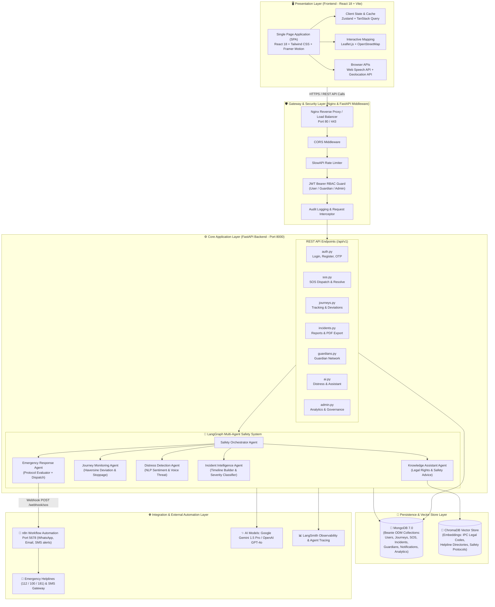
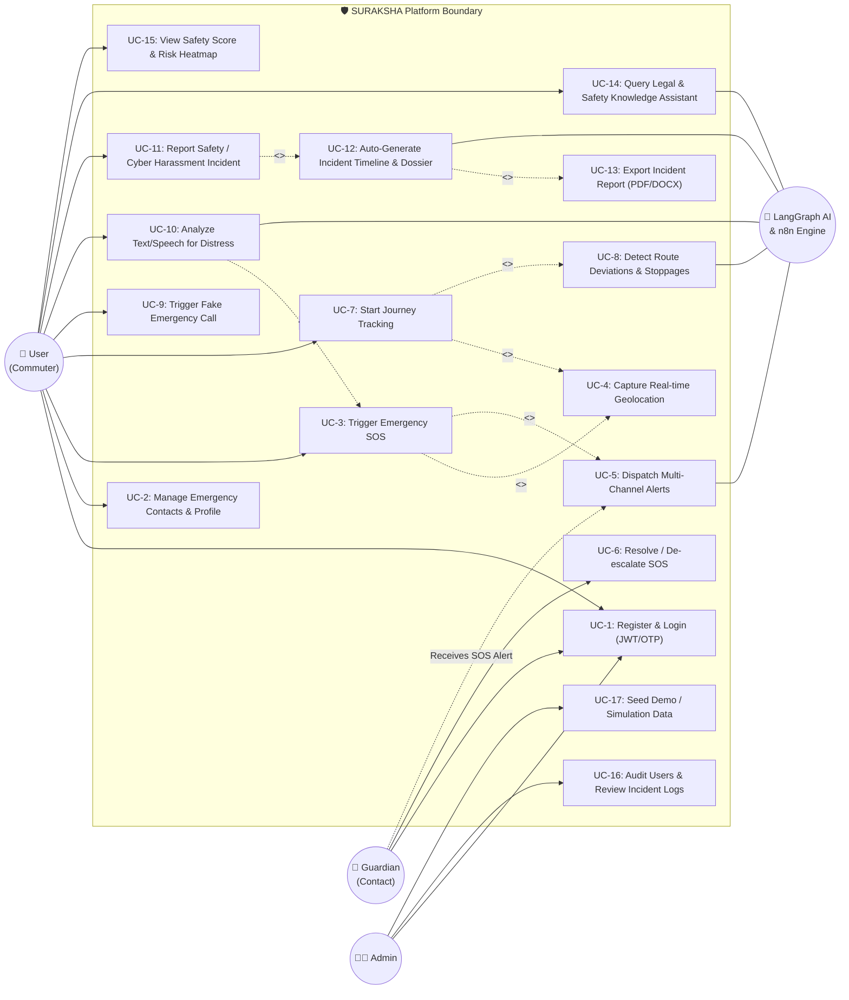
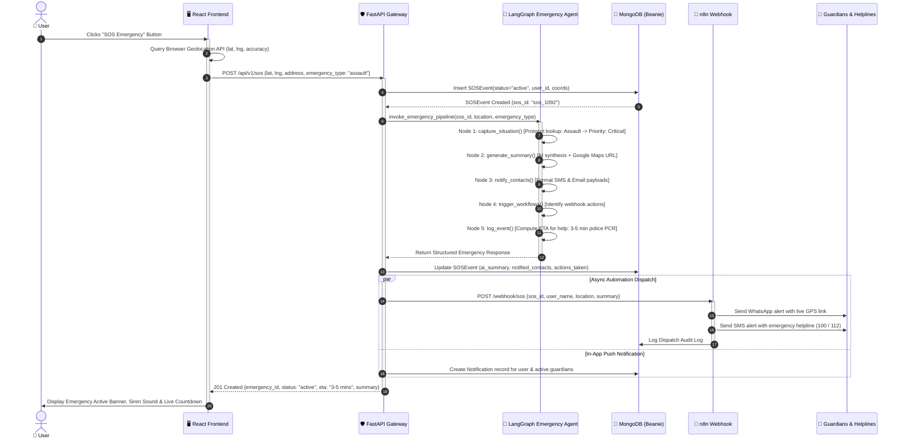
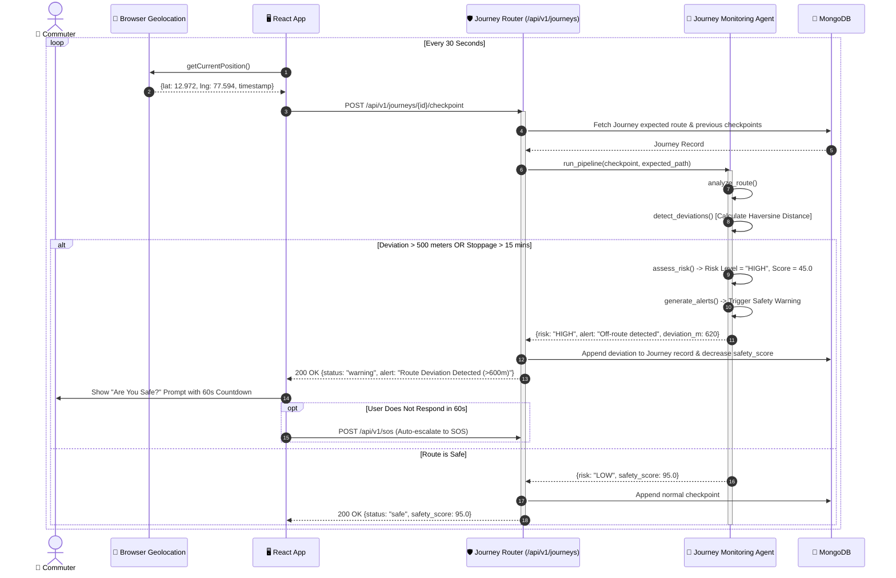
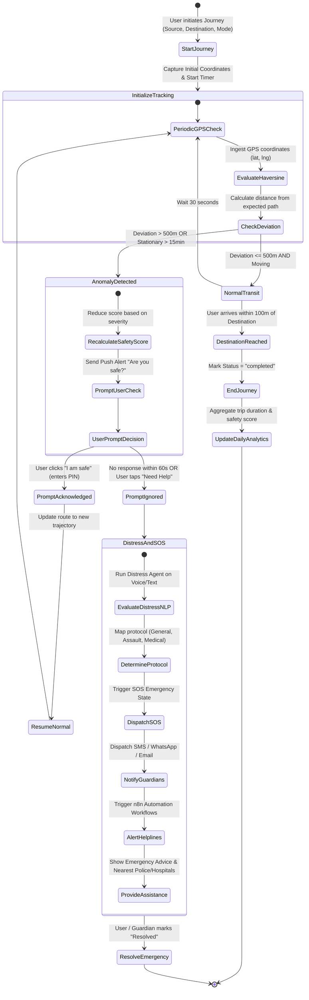

# 🛡️ SURAKSHA — Software Requirements & UML Architecture Documentation

> **AI Women Safety Companion Platform**  
> *Ready-to-use specifications and diagrams for Project Documentation and PPT Presentation*

---

## Table of Contents
1. [Functional & Non-Functional Requirements](#1-functional--non-functional-requirements)
2. [System Architecture Diagram](#2-system-architecture-diagram)
3. [Entity-Relationship (ER) Diagram](#3-entity-relationship-er-diagram)
4. [Use Case Diagram](#4-use-case-diagram)
5. [Sequence Diagrams](#5-sequence-diagrams)
   - 5.1 SOS Emergency Trigger & Orchestration
   - 5.2 Journey Monitoring & Anomaly Detection
6. [Activity Diagram](#6-activity-diagram)
7. [Deployment Diagram](#7-deployment-diagram)
8. [Slide-by-Slide Presentation Guide (PPT Ready)](#8-slide-by-slide-presentation-guide)

---

## 1. Functional & Non-Functional Requirements

### 1.1 Functional Requirements (FR)

| ID | Feature Domain | Description | Priority |
| :--- | :--- | :--- | :--- |
| **FR-01** | **User Authentication & RBAC** | Support registration, bcrypt password hashing, JWT access/refresh token rotation, email OTP verification, and role-based access control (`user`, `guardian`, `admin`). | Must Have |
| **FR-02** | **One-Tap SOS Emergency** | Instant trigger of emergency alarm capturing real-time GPS coordinates, reverse-geocoded address, emergency type (`general`, `medical`, `assault`, `stalking`, `accident`), and automated summary. | Must Have |
| **FR-03** | **Guardian Network** | Manage trusted contacts with relationship tagging, invitation status tracking (`pending`, `active`, `declined`), and customizable notification preferences. | Must Have |
| **FR-04** | **Journey Tracking & Anomaly Detection** | Real-time GPS path logging with automatic detection of route deviations (>500m using Haversine algorithm), prolonged stoppages (>15 min), and expected arrival delays (>20%). | Must Have |
| **FR-05** | **Distress Detection Engine** | AI-driven sentiment and threat analysis of user text/voice input, classifying danger levels into 4 tiers: `Safe` (80-100), `Concern` (60-79), `Warning` (40-59), and `Emergency` (<40). | Must Have |
| **FR-06** | **Incident Intelligence & Reporting** | Allow reporting of safety violations (harassment, stalking, assault, cyber threats), auto-generate chronological timelines and severity assessments, and export reports in PDF/DOCX formats. | Should Have |
| **FR-07** | **RAG Safety & Legal Knowledge Assistant** | Conversational AI grounded on ChromaDB vector store containing Indian Penal Code (IPC), women's legal rights, emergency helplines, and actionable safety protocols. | Should Have |
| **FR-08** | **Discreet Protection (Fake Call Simulator)** | Built-in incoming call simulation interface with selectable caller identities (e.g., "Dad", "Police Officer") and timed ring triggers to assist users in discreetly exiting unsafe environments. | Should Have |
| **FR-09** | **Safety Score & Risk Analytics** | Dynamic 0–100 safety score calculator evaluating trip histories, incident vicinity, time-of-day risks, and user safety check compliance, visualized on interactive heatmaps. | Should Have |
| **FR-10** | **Admin Governance & Telemetry** | Administrative portal to inspect all platform users, monitor active SOS states, view audit logs, run analytics, and seed mock demonstration data. | Could Have |

---

### 1.2 Non-Functional Requirements (NFR)

| Category | ID | Requirement | Target Metric / Specification |
| :--- | :--- | :--- | :--- |
| **Performance** | NFR-01 | **SOS Response Latency** | SOS event creation and contact notification pipeline initiation must complete within **< 500 ms**. |
| **Performance** | NFR-02 | **GPS Checkpoint Ingestion** | Location telemetry endpoints must process incoming checkpoints in **< 200 ms**. |
| **Security** | NFR-03 | **Data Protection & Encryption** | All transport encrypted via **TLS 1.3 / HTTPS**. Passwords hashed with **bcrypt (cost factor 12)**. Sensitive tokens masked in audit logs. |
| **Security** | NFR-04 | **API Rate Limiting** | Strict rate limits using SlowAPI (e.g., 5 requests/min for Auth endpoints, 100 requests/min default) to mitigate brute-force and DDoS attacks. |
| **Reliability** | NFR-05 | **Graceful AI Fallback** | When external LLM APIs (Gemini/OpenAI) or network connections fail, the platform must seamlessly fall back to local rule-based mock pipelines without throwing 500 errors. |
| **Availability** | NFR-06 | **High Uptime** | Platform core services designed for **99.9% uptime** through containerized multi-process deployment (Docker, Uvicorn, Nginx). |
| **Usability** | NFR-07 | **Rapid Emergency Access** | High-visibility floating SOS button reachable within **1 click** from any viewport or screen. Mobile-first responsive layout (Tailwind CSS). |
| **Interoperability**| NFR-08 | **Automated Webhook Integration** | Standard REST/Webhook integration with **n8n** automation engine for multi-channel messaging (WhatsApp, SMS, Email, external emergency dispatches). |

---

## 2. System Architecture Diagram

SURAKSHA follows a modern **Cloud-Native, Multi-Agent Microservices Architecture** split into four decoupled layers: Client, Gateway & Security, Application & AI Agentic Core, and Persistence & External Services.



---

## 3. Entity-Relationship (ER) Diagram

The data persistence layer is implemented using MongoDB with the **Beanie Asynchronous ODM** (Object-Document Mapper) backed by **Pydantic v2 schemas**.

```mermaid
erDiagram
    USER ||--o{ GUARDIAN : "registers/trusts"
    USER ||--o{ JOURNEY : "embarks_on"
    USER ||--o{ SOS_EVENT : "triggers"
    USER ||--o{ INCIDENT : "reports"
    USER ||--o{ NOTIFICATION : "receives"
    USER ||--o{ FEEDBACK : "submits"
    USER ||--o{ ANALYTICS : "tracks_daily"

    USER {
        ObjectId _id PK
        string email UK "Indexed, unique"
        string username UK "Indexed, unique"
        string full_name
        string phone
        string password_hash "Bcrypt hash"
        string role "user | guardian | admin"
        float safety_score "0.0 - 100.0"
        boolean is_active
        boolean is_verified
        string profile_picture
        list emergency_contacts "Embedded [{name, phone, email, relation}]"
        dict location "{lat, lng, address, updated_at}"
        string otp "Verification / Reset OTP"
        datetime otp_expiry
        datetime created_at
        datetime updated_at
        datetime last_login
    }

    GUARDIAN {
        ObjectId _id PK
        string user_id FK "Refers to USER"
        string guardian_email
        string guardian_name
        string guardian_phone
        string relationship "parent | sibling | friend | spouse | other"
        string status "pending | active | declined"
        dict notification_prefs "{sos_alerts, journey_updates, daily_summary}"
        datetime created_at
        datetime updated_at
    }

    JOURNEY {
        ObjectId _id PK
        string user_id FK "Refers to USER"
        string source
        string destination
        dict source_coords "{lat, lng}"
        dict destination_coords "{lat, lng}"
        string travel_mode "walking | auto | bus | metro | cab"
        string status "active | completed | emergency"
        datetime start_time
        datetime end_time
        int expected_duration "Minutes"
        int actual_duration "Minutes"
        list checkpoints "[{lat, lng, timestamp, note}]"
        list deviations "[{lat, lng, distance_meters, timestamp}]"
        float safety_score "Journey risk score"
        dict ai_analysis "AI risk assessment & recommendations"
        datetime created_at
    }

    SOS_EVENT {
        ObjectId _id PK
        string user_id FK "Refers to USER"
        dict location "{lat, lng, address}"
        string emergency_type "general | medical | assault | stalking | accident"
        string status "active | resolved | false_alarm"
        string message "User SOS text or voice note"
        string ai_summary "LLM-generated emergency assessment"
        list notified_contacts "[{name, phone, email, notified_at, method}]"
        int response_time "Seconds to acknowledgment"
        datetime resolved_at
        string resolved_by "user | guardian | admin"
        datetime created_at
    }

    INCIDENT {
        ObjectId _id PK
        string user_id FK "Refers to USER"
        string title
        string description
        string incident_type "harassment | stalking | assault | theft | cyber | other"
        string severity "low | medium | high | critical"
        dict location "{lat, lng, address, area}"
        string status "open | under_review | resolved | closed"
        list ai_timeline "[{timestamp, event, severity}]"
        string ai_summary "LLM synthesized incident overview"
        list recommended_actions "Action steps & legal remedies"
        list tags "Category tags"
        list attachments "[{filename, url, type, size}]"
        list exported_formats "['pdf', 'docx']"
        datetime incident_time
        datetime created_at
        datetime updated_at
    }

    NOTIFICATION {
        ObjectId _id PK
        string user_id FK "Refers to USER"
        string type "sos | journey | guardian | ai_alert | system | incident"
        string title
        string message
        boolean is_read
        dict metadata "{related_id, action_url, icon}"
        datetime created_at
    }

    FEEDBACK {
        ObjectId _id PK
        string user_id FK "Refers to USER"
        string feature "ai_chat | journey | sos | incident | dashboard"
        int rating "1 to 5 stars"
        string comment
        datetime created_at
    }

    ANALYTICS {
        ObjectId _id PK
        string user_id FK "Refers to USER"
        string date "YYYY-MM-DD"
        float safety_score
        int journeys_count
        int incidents_count
        int sos_count
        int ai_interactions
        string risk_level "low | medium | high | critical"
        int completed_journeys
        int emergency_journeys
        float avg_journey_duration
        datetime created_at
    }
```



---

## 4. Use Case Diagram

The Use Case model defines the functional boundary of SURAKSHA across 4 primary actors:
1. **Woman / Commuter (Primary User)**
2. **Guardian / Trusted Contact**
3. **Platform Administrator**
4. **LangGraph Safety AI / Automation System (Secondary System Actor)**



---

## 5. Sequence Diagrams

### 5.1 SOS Emergency Trigger & Multi-Agent Orchestration
This diagram demonstrates the end-to-end event-driven flow triggered when a user taps the SOS emergency button.



---

### 5.2 Journey Monitoring & Route Anomaly Detection Flow
This sequence captures background periodic GPS telemetry checks during an active travel journey.



---

## 6. Activity Diagram

The Activity Diagram illustrates the **Complete Journey Monitoring, Distress Evaluation & SOS Escalation Lifecycle**.



---

## 7. Deployment Diagram

This deployment diagram details the physical and containerized node infrastructure as configured in `docker-compose.yml` and cloud production setups.

```mermaid
graph TB
    subgraph Client_Device["📱 Client Node (Smartphone / Laptop Browser)"]
        Browser["User Web Browser\n(Google Chrome / Safari / Firefox)\n- PWA / Responsive Web App\n- Geolocation Sensor\n- Web Audio & Speech API"]
    end

    subgraph Host_Server["🖥️ SURAKSHA Docker Host / Cloud VM (Ubuntu Linux)"]
        subgraph Docker_Network["Docker Bridge Network: suraksha_net"]
            
            subgraph Container_Frontend["Container: suraksha_frontend"]
                Nginx["Nginx Alpine Web Server\nPort: 80 (HTTP) / 443 (TLS)\nServes Built React Static Assets (HTML/JS/CSS)"]
            end

            subgraph Container_Backend["Container: suraksha_backend"]
                Uvicorn["Uvicorn ASGI Server\nPort: 8000\nFastAPI Application Runtime\n- LangGraph Agent Engine\n- Beanie Async ODM\n- Pydantic v2 Models"]
            end

            subgraph Container_MongoDB["Container: suraksha_mongodb"]
                MongoService["MongoDB 7.0 Engine\nPort: 27017\nDatabase: suraksha_db"]
                MongoVolume[("Volume:\nmongo_data\n(/data/db)")]
                MongoService --- MongoVolume
            end

            subgraph Container_ChromaDB["Container: suraksha_chromadb"]
                ChromaService["ChromaDB Vector Store\nPort: 8001 -> 8000\nPersistent Vector Indices"]
                ChromaVolume[("Volume:\nchroma_data\n(/chroma/chroma)")]
                ChromaService --- ChromaVolume
            end

            subgraph Container_N8N["Container: suraksha_n8n"]
                N8NService["n8n Automation Engine\nPort: 5678\nWorkflow Orchestration"]
                N8NVolume[("Volume:\nn8n_data\n(/home/node/.n8n)")]
                N8NService --- N8NVolume
            end

        end
    end

    subgraph External_Cloud["☁️ External Cloud Services & APIs"]
        GeminiAPI["Google Gemini 1.5 Pro API\n(Generative AI & Knowledge Agent)"]
        OpenAIAPI["OpenAI GPT-4o API (Optional Fallback)"]
        LangSmithCloud["LangSmith Tracing Platform\n(Agent Observability & Traces)"]
        NotificationGateways["Twilio / WhatsApp Business API / SendGrid"]
        EmergencyDispatch["Emergency Services & Helplines (112 / 100 / 181)"]
    end

    %% Network links
    Browser -->|HTTP / HTTPS (Port 80/443)| Nginx
    Nginx -->|Reverse Proxy /api/v1 -> Port 8000| Uvicorn
    Uvicorn -->|TCP Wire Protocol (Port 27017)| MongoService
    Uvicorn -->|HTTP REST Client (Port 8001)| ChromaService
    Uvicorn -->|Webhook HTTP POST (Port 5678)| N8NService
    
    Uvicorn -->|HTTPS API Requests| GeminiAPI
    Uvicorn -->|HTTPS API Requests| OpenAIAPI
    Uvicorn -->|Telemetry HTTPS| LangSmithCloud
    N8NService -->|HTTPS Webhooks / SMTP| NotificationGateways
    NotificationGateways --> EmergencyDispatch
```

---

## 8. Slide-by-Slide Presentation Guide (PPT Ready)

Use these curated slide outlines for your project evaluation or design presentation.

### 📽️ Slide 1: Title & Problem Statement
- **Title**: SURAKSHA — AI-Powered Women Safety Companion Platform
- **Problem**: Women face safety vulnerabilities during daily commutes, cyber harassment, and lack immediate, automated emergency response mechanisms.
- **Solution**: An autonomous, proactive multi-agent platform combining real-time journey anomaly tracking, NLP distress detection, automated emergency escalation, and legal intelligence.

### 📽️ Slide 2: Key Functional & Non-Functional Highlights
- **Functional**: 1-Tap SOS, Route Deviation Detection (>500m Haversine), Distress NLP Analyzer, Guardian Network, RAG Legal Chatbot, Fake Emergency Call.
- **Non-Functional**: Sub-500ms SOS latency, end-to-end TLS & bcrypt encryption, 99.9% uptime, graceful offline/mock fallback when LLMs disconnect.

### 📽️ Slide 3: High-Level System Architecture
- *Show the System Architecture Diagram (Section 2)*
- **Talking Points**: 
  - 4-Tier Architecture: Presentation (React), Gateway/Security (Nginx + FastAPI Middleware), Core Application (LangGraph Multi-Agents), and Persistence (MongoDB + ChromaDB).
  - Multi-agent orchestration isolates responsibilities: Distress Agent, Journey Agent, Emergency Agent, and RAG Knowledge Agent.

### 📽️ Slide 4: Data Architecture & ER Diagram
- *Show the ER Diagram (Section 3)*
- **Talking Points**:
  - 8 Beanie ODM documents mapped cleanly in MongoDB.
  - Efficient embedded sub-documents for coordinates and checkpoints; indexed unique email and usernames.
  - Explicit foreign-key relations linking Users to Journeys, SOS Events, Guardians, Incidents, and Daily Analytics snapshots.

### 📽️ Slide 5: Actor Interaction & Use Cases
- *Show the Use Case Diagram (Section 4)*
- **Talking Points**:
  - Highlights user personas (Commuter, Guardian, Administrator, and AI System).
  - Emphasize `<<include>>` relationships: triggering an SOS automatically includes GPS capture and guardian alert dispatch.

### 📽️ Slide 6: Critical Sequence: SOS Emergency Pipeline
- *Show the SOS Sequence Diagram (Section 5.1)*
- **Talking Points**:
  - From button tap to multi-channel alerting takes under 500 ms.
  - LangGraph executes a 5-step pipeline: Capture $\rightarrow$ Summarize $\rightarrow$ Format $\rightarrow$ Trigger $\rightarrow$ Log.
  - Asynchronously integrates with n8n to send WhatsApp and SMS messages simultaneously.

### 📽️ Slide 7: Algorithmic Logic: Journey Monitoring & Activity Flow
- *Show the Activity Diagram (Section 6)*
- **Talking Points**:
  - Uses the Haversine spherical trigonometric formula to calculate true GPS distance deviations.
  - Automatic escalation: if the user ignores safety prompts during a critical deviation, the system autonomously triggers an SOS alert.

### 📽️ Slide 8: Deployment & Container Topology
- *Show the Deployment Diagram (Section 7)*
- **Talking Points**:
  - Complete multi-container Docker Compose configuration (`frontend`, `backend`, `mongodb`, `chromadb`, `n8n`).
  - Isolated bridge network (`suraksha_net`) with persistent named volumes preventing data loss.
  - Cloud-ready for deployment on AWS EC2, GCP Compute Engine, or Azure Container Apps.

---
*Documentation compiled and verified for the SURAKSHA AI Women Safety Platform.*
